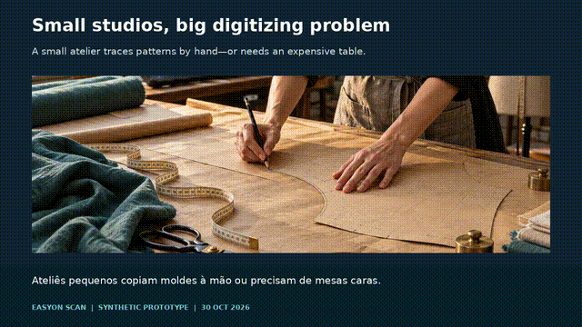

# easyon-scan

Turn a phone photograph of a flat paper sewing pattern into a closed DXF outline
in millimetres. Python 3.11+, Apache-2.0. Early experimental release.



[Watch with narration (MP4, 57 s)](docs/easyon-scan.mp4)

## Test it in 5 minutes

```sh
python3 -m venv .venv
. .venv/bin/activate
pip install -e .
easyon-scan sheet --out markers-free-a4.pdf
# Optional: one card per A4 sheet, using different IDs:
# easyon-scan sheet --id 0 --out marker-0.pdf
```

Or download [markers-free-a4.pdf](markers-free-a4.pdf). Print at **100% / actual
size**, without fitting to the page. Check the 100 mm ruler and each black
90 × 90 mm square with a physical ruler. Cut the four cards along the cut lines,
keeping their white borders.

Place the cards on all sides so they **surround the entire pattern with clearance**
on a dark, matte table, with any rotation. No rectangle, tape measure or prescribed spacing is needed. Use four
or more distinct ArUco DICT_4X4_50 IDs (0–49), all with 90 mm black squares.
Keep the cards and light paper flat in the **same plane**, with a gap between
cards and pattern. The complete pattern must sit well inside the markers' convex
hull (the boundary joining the outermost markers). Contours touching that boundary
or the marker cards are rejected. Leave a visible strip of dark table all around.

```text
[ID 0]                         [ID 1]
       +-------------------+
       |   paper pattern   |
       +-------------------+
          dark table gap
[ID 3]                         [ID 2]
```

Keep other light objects and spare paper off the working area.

Photograph from above with the whole pattern and all markers visible. Use even
lighting and the original photograph; avoid glare, shadows and ultrawide lenses.

```sh
easyon-scan web
# Open http://127.0.0.1:8765 and upload the photograph.
# Or:
easyon-scan measure photo.jpg --out pattern.dxf --preview preview.png
```

The page shows the outline, dimensions, area and marker residual in **mm**, with
a warning above 1 mm, and offers a DXF download. Uploads and exports stay in
request memory. Limits: 25 MB / 40 megapixels; the server binds to localhost.

In free mode width and height are the shorter and longer sides of the minimum
rotated bounding rectangle. Coordinates use the lowest detected marker ID as
the reference frame (origin at its first corner, y down). DXF uses millimetres,
a closed LWPOLYLINE on OUTLINE, and y up with its origin at the outline's lower
left. No marker pose is prescribed.

### Optional fixed layout

Use `--layout fixed` with `sheet`, `measure` or `web` for the original layout.
All markers must point up, with black-square top-left corners at:

| ID | x (mm) | y (mm) |
|---|---:|---:|
| 0 | 0 | 0 |
| 1 | 690 | 0 |
| 2 | 690 | 890 |
| 3 | 0 | 890 |

The envelope is 780 × 980 mm. Keep the pattern within x=90…690, y=90…890,
with 3 mm clearance. Fixed-mode width and height follow the layout axes.

## Synthetic smoke test

No printer or camera needed:

```sh
pip install -e '.[test]'
python -m easyon_scan.synthetic synthetic.png
easyon-scan measure synthetic.png --out pattern.dxf --preview preview.png
pytest -q
```

Tests exercise random free marker poses with 4 and 6 cards at camera tilts
0°, 10°, 20° and 35°, fixed layout, perspective and JPEG input, requiring
width/height error below 1 mm
against a known 400 × 600 mm rectangle, reread the DXF with ezdxf, check PDF page
sizes, test the upload/download flow, and reject missing references/paper.

## Accuracy and limits

The preceding research prototype reported **synthetic mean contour error around
0.05 mm** under selected calibrated conditions (not width/height error and not a
real-photo guarantee). This smaller package has a separate synthetic smoke test;
it does not reproduce that full benchmark. **Real phone photos are not yet
validated.** Successful marker detection does not certify the resulting scale.

The scanner detects ArUco DICT_4X4_50 markers. Free calibration starts from one
90 mm square, maps the other corners into that plane, and initializes each
unknown pose with a rigid 2D fit. Five damped Gauss–Newton iterations jointly
refine the image-to-plane homography and all other marker rotations/translations
against every corner. The first marker fixes the arbitrary coordinate frame.
The reported residual is RMS Euclidean corner error in mm; above 1 mm produces
a warning. Coherent printer scale errors can still pass this check.

Light contours inside the marker hull are checked for relative area, solidity
and clearance from cards and the hull. Multiple plausible contours are rejected
with a request to remove light objects. No rectangular shape is required. Its intensity edge is refined in the source photo before mapping
to mm. Rectification is used for preview only, capped at 4000 pixels per side.
Degenerate homographies and extreme working hulls are rejected.

Lens distortion is not corrected. Printer scaling, placement error, paper curl,
shadows and poor contrast can dominate the error. Use the same plane for paper
and markers. White tables, multiple pieces, holes and interior markings are not
supported. Inspect the preview and independently check dimensions before use.
Only the outer contour is exported: **no notches, grain line, seam allowance,
grading or AAMA/ASTM semantics**. Audaces compatibility has not been validated.

The detector uses AprilTag corner refinement followed by explicit subpixel
refinement: local OpenCV 4.13/4.14 default ArUco refinement displaced the
corners on the clean fixture.
Dependencies carry their own licenses and bundled binary notices; Apache-2.0
applies to this project's code, not all third-party binary components.

## Roadmap

- Validate against measured real phone photographs and publish error distributions.
- Add camera calibration / lens distortion correction and stronger quality checks.
- Support custom marker sizes and persisted layouts.
- Detect notches and grain lines; add AAMA/ASTM export.
- Add multi-photo stitching and broader lighting/contrast fixtures.

## Provenance and development

The numerical approach and the `sample` / `cruzamento` subpixel helpers were
adapted from the read-only MOLDES-0 prototype's `pipeline/extrair.py`, reviewed
alongside its README, decisions, method, engine and DXF example. No prototype
photos, scene datasets, logs or generated outputs are distributed here.

```sh
pip install -e '.[test]'
pytest -q
```

See [LICENSE](LICENSE) for Apache License 2.0.
