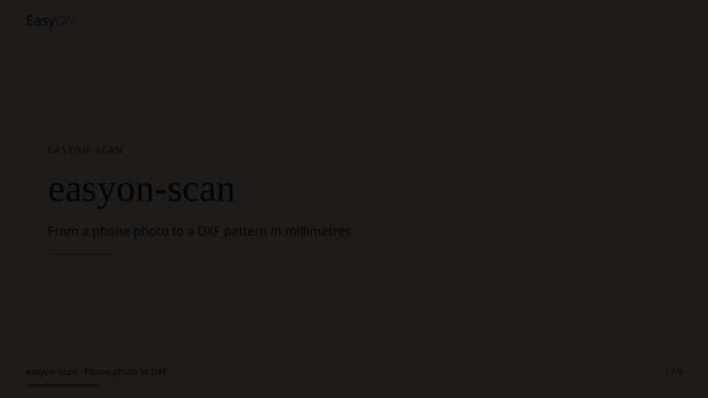

# easyon-scan

Turn a phone photograph of flat paper sewing pieces into closed DXF outlines
in millimetres. Python 3.11+, Apache-2.0. Early experimental release.



[Watch with narration (MP4, 57 s)](docs/easyon-scan.mp4)

## Test it in 5 minutes

```sh
python3 -m venv .venv
. .venv/bin/activate
pip install -e .
easyon-scan sheet --out markers-free-a4.pdf
# Optional: one card per A4 sheet, using different IDs:
# easyon-scan sheet --id 0 --out marker-0.pdf
```

Or download [markers-free-a4.pdf](markers-free-a4.pdf). Print at **100% / actual
size**, without fitting to the page. Check the 100 mm ruler and each black
90 × 90 mm square with a physical ruler. Cut the four cards along the cut lines,
keeping their white borders.

Place the cards on all sides so they **surround the entire pattern with clearance**
on a dark, matte table, with any rotation. No rectangle, tape measure or prescribed spacing is needed. Use four
or more distinct ArUco DICT_4X4_50 IDs (0–49), with 90 mm black squares by default (custom sizes below).
Keep the cards and light paper flat in the **same plane**, with a gap between
cards and pattern. The complete pattern must sit well inside the markers' convex
hull (the boundary joining the outermost markers). Contours touching that boundary
or the marker cards are rejected. Leave a visible strip of dark table all around.

```text
[ID 0]                         [ID 1]
       +-------------------+
       |   paper pattern   |
       +-------------------+
          dark table gap
[ID 3]                         [ID 2]
```

Keep other light objects and spare paper off the working area: every plausible
separate light region is treated as a piece. Leave at least 3 mm between pieces.
Overlapping or touching pieces cannot be separated reliably.

Photograph from above with the whole pattern and all markers visible. Use even
lighting and the original photograph; avoid glare, shadows and ultrawide lenses.

```sh
easyon-scan web
# Open http://127.0.0.1:8765 and upload the photograph.
# Or:
easyon-scan measure photo.jpg --out pattern.dxf --preview preview.png
```

The page shows the outline, dimensions, area and marker residual in **mm**, with
a warning above 1 mm, and offers a DXF download. Uploads and exports stay in
request memory. Limits: 25 MB / 40 megapixels; the server binds to localhost.

In free mode width and height are the shorter and longer sides of the minimum
rotated bounding rectangle. Coordinates use the lowest detected marker ID as
the reference frame (origin at its first corner, y down). DXF uses millimetres,
closed LWPOLYLINEs, and y up with a shared origin at the lower left of all
pieces. A single piece uses OUTLINE; multiple pieces use PIECE_001, PIECE_002,
etc., ordered by minimum x then y in the marker reference frame. Each layer
contains its outer ring and interior holes, with opposite winding (outer
counterclockwise, holes clockwise in DXF). Relative placement is preserved.
Width/height describe the bounding envelope of all pieces; area is the sum of
piece areas minus holes. CLI JSON includes piece count, per-piece area and hole
count. The Python result exposes `pieces`, each with `contour_mm` and `holes_mm`;
pass the complete result to `dxf_bytes` / `export_dxf` to export all rings.
The legacy `result.contour_mm` field contains only the first piece's outer ring.
The legacy Nx2 export argument still exports one outer contour. No marker pose is prescribed.

### Camera calibration and photo quality

```sh
easyon-scan calibrate --board charuco-a4.pdf
# Print at actual size, mount flat, and verify 30 mm squares with a ruler.
# Take at least six sharp photos with varied tilts, distances and board positions.
easyon-scan calibrate calibration/*.jpg --phone my-phone-main --out my-phone.json
easyon-scan measure photo.jpg --profile my-phone.json --out pattern.dxf
```

The A4 board has 6 × 8 ChArUco squares (30 mm, markers 22 mm,
DICT_4X4_50). Calibration requires at least 12 detected corners per view,
varied frame coverage, matching oriented resolutions and RMS reprojection
error at most 2 pixels. The versioned JSON stores the phone label, resolution,
camera matrix, OpenCV distortion coefficients, view count and fit RMS. The fit
uses two radial terms and tangential distortion (k3 fixed at zero).
Use a separate profile per phone, lens, zoom and capture mode. Resolution
mismatches are rejected; other capture-setting mismatches cannot be detected.
EXIF orientation is applied before calibration and measurement. Correction
runs before marker detection and contour extraction. Fit RMS is not a real
measurement accuracy estimate.

The web page accepts an optional profile JSON upload. CLI JSON and the page
show quality checks and actionable hints. Checks run before contour measurement:
minimum marker edge 35 px; minimum normalized marker Laplacian variance 100;
marker white/black contrast at least 60 intensity levels; clipping fraction
warning above 80%; paper/card illumination spread warning above 25% and rejection
above 55%; homography local anisotropy rejection above 3; marker RMS warning
above 1 mm and rejection above 2 mm. The homography ratio is a tilt proxy,
not a camera angle. These are experimental heuristics, not validated safety
or accuracy thresholds. Missing or undetectable markers can prevent checks.
Rejected CLI measurements exit 2 and output JSON with the error and available
checks; no DXF is exported. The web page displays rejection checks and hints.

Without a profile, an explicit lens warning is always included: some distortion
can escape consistency checks. Every result warns to physically verify the declared sizes of
cards: uniform printer scaling is unobservable from the photo. Unequal scale,
nonplanarity and distortion may raise marker residuals but cannot be uniquely
identified. Passing checks never certifies scale or real-photo accuracy.

### Custom sizes and reusable layouts (SCAN-8)

Declare the **black square** side in millimetres for each nonstandard ID;
unspecified IDs remain 90 mm. Sizes must be positive and IDs must be 0–49.
Custom sizes and saved layouts use free mode. Fixed mode retains its original
90 mm geometry. These options are available in the CLI and Python API; the web
upload and camera UI retain their default sizes and single-photo workflow.

```sh
# One page per declared ID, with white borders, size label and 100 mm ruler:
easyon-scan sheet --marker-size 0=90,1=60 --out mixed-cards.pdf
# Add --id 1 to print only that ID; A4/A3 cards that do not fit are rejected.
easyon-scan measure first.jpg --marker-size 0=90,1=60 \
  --save-layout table.json --out first.dxf
easyon-scan measure next.jpg --layout-file table.json --out next.dxf
```

Keep every marker stationary when reusing a layout. Saving records the fitted
marker poses, not camera coordinates. JSON has `version: 1`, `units: "mm"` and
`markers`, mapping ID strings to four ordered `[x,y]` black-square corners
(top-left, top-right, bottom-right, bottom-left in the marker's own orientation).
It preserves the first calibration's frame and declared sizes across photos.
Every detected marker must occur in the JSON; conflicting explicit sizes are
rejected. Single-photo measurements still require four visible markers. Python:
`measure(image, marker_size={0: 90, 1: 60}, save_layout="table.json")`, then
`measure(other, layout_file="table.json")`. Results expose `markers` keyed by ID.
Verify every printed square physically: uniform printer scaling remains invisible.

### Patterns spanning several photos (SCAN-13)

```sh
easyon-scan measure left.jpg middle.jpg right.jpg \
  --marker-size 0=90,1=60 --save-layout table.json \
  --out whole-pattern.dxf --preview stitched.png
# Reuse the same stationary marker layout with --layout-file table.json.
```

Each photo needs at least two distinct fully visible markers, and must share
**at least two IDs with another photo**. The overlap graph must be connected;
a chain is sufficient. Use distinct IDs for distinct cards throughout the set.
Keep all cards and paper stationary and coplanar. The union of photos must cover
the entire marker hull without gaps; surround the complete pattern with cards.
The pattern may cross individual photo edges, but must leave clearance from
cards and the outer hull in the combined view. Use consistent diffuse lighting.

`easyon_scan.stitch.stitch([image_a, image_b], marker_size={...})` returns the
same Measurement type and accepts `profile`, `layout_file` and `save_layout`.
Registration initializes through shared IDs, then alternates fits of all photo
homographies and rigid marker poses in one plane, fixing one marker as the frame.
A saved layout fixes all marker poses instead. `residual_mm` is the RMS Euclidean
corner discrepancy over **all observations in all photos**; `residual_px` is its
source-image reprojection counterpart. Per-photo quality checks carry a 1-based `photo`
index; `joint_marker_consistency_mm` reports the aggregate fit. Per-photo checks and the 2 mm rejection threshold apply; above 1 mm warns.

The aligned images form a 1 pixel/mm light-paper union mosaic (maximum intensity
in overlaps), and the normal contour/hole extraction merges partial outlines
there. This can widen edges under misregistration or fill holes under inconsistent
lighting; inspect the preview. A low residual cannot rule out every marker
movement or coherent scale error. Mosaics are limited to 40 megapixels and 10 m per
side. The mosaic sampling adds quantization absent from single-photo subpixel
measurement. Synthetic tests cover mixed 90/60 mm cards, saved-layout reuse,
projectively different crops across 2–3 photos, a hole across a photo boundary,
and insufficient overlap or moved markers. These tests do not validate real-photo
stitching accuracy.

### Optional fixed layout

Use `--layout fixed` with `sheet`, `measure` or `web` for the original layout.
All markers must point up, with black-square top-left corners at:

| ID | x (mm) | y (mm) |
|---|---:|---:|
| 0 | 0 | 0 |
| 1 | 690 | 0 |
| 2 | 690 | 890 |
| 3 | 0 | 890 |

The envelope is 780 × 980 mm. Keep the pattern within x=90…690, y=90…890,
with 3 mm clearance. Fixed-mode width and height follow the layout axes.

## Synthetic smoke test

No printer or camera needed:

```sh
pip install -e '.[test]'
python -m easyon_scan.synthetic synthetic.png
easyon-scan measure synthetic.png --out pattern.dxf --preview preview.png
pytest -q
```

Tests exercise random free marker poses with 4 and 6 cards at camera tilts
0°, 10°, 20° and 35°, fixed layout, perspective and JPEG input, requiring
width/height error below 1 mm
against a known 400 × 600 mm rectangle, reread the DXF with ezdxf, check PDF page
sizes, test the upload/download flow, and reject missing references/paper.
Multi-piece cases cover two pieces with holes in free/fixed layouts, perspective,
DXF layer assignment, winding, net area and shared placement, plus rejection of
nested islands, insufficient piece separation and card/hull contacts.

### Synthetic photo batches

Generate fixed-layout cases without a printer or camera:

```sh
easyon-scan synthetic --out cases --count 10 --seed 2026 \
  --tilt-deg 20 --radial-k1 0.04 --shadow 0.25 --curl-mm 2 \
  --lighting 0.25 --printer-scale 1.02 --noise-sigma 3 --jpeg-quality 65
# These fixtures use the fixed marker layout:
easyon-scan measure cases/case-0000.png --layout fixed --out pattern.dxf
python scripts/benchmark.py --count 3 --seed 2026
pytest -q  # Includes the small benchmark marked slow
# To skip the benchmark test: pytest -q -m 'not slow'
```

The batch contains lossless `case-NNNN.png` files and `manifest.json` (schema
version 1). Each entry records its filename, seed, layout, exact parameters and
nominal ground truth: width/height in mm, area in mm², contour coordinates in mm
in the fixed-layout frame, and actual printed black-square size in mm. Case i
uses seed + i. Existing case files or manifests are refused. Reproduction assumes
the same NumPy/OpenCV versions. PNG preserves the simulated JPEG artifacts without
an additional lossy save.

The Python API is `generate_case(seed=..., parameters=Parameters(...))`, returning
an image and metadata; `generate_batch(folder, count=..., seed=..., parameters=...)`
writes a manifest. Existing `generate` and `generate_free` fixtures remain available.
All effects default to disabled (`printer_scale=1`, `jpeg_quality=100`). Parameters:

| Parameter | Range | Model |
|---|---|---|
| `tilt_deg` | −45…45 degrees | Pinhole plane projection about the horizontal camera axis, with wider framing at larger tilts |
| `radial_k1` | −0.4…0.4 | Inverse radial sampling, radius normalized by half the image diagonal |
| `shadow` | 0…0.9 | Broad soft Gaussian attenuation |
| `curl_mm` | 0…20 mm | Sinusoidal horizontal displacement of the paper, random phase |
| `lighting` | 0…0.9 | Multiplicative linear illumination gradient |
| `printer_scale` | 0.9…1.1 | Uniform scaling of marker cards only (0.98 means 98%) |
| `noise_sigma` | 0…50 intensity levels | Independent Gaussian sensor noise, clipped to 8 bits |
| `jpeg_quality` | integer 1…100 | JPEG encode/decode; 100 bypasses compression |

Effects apply as card scaling, waviness, shadow/lighting, perspective, radial
distortion, sensor noise, then JPEG compression. The pattern's independent nominal size stays
400 × 600 mm, including when cards are printed at the wrong scale. Curl is a
projected waviness approximation, not a physical 3D paper model or a change to
material dimensions. These controlled defects are sensitivity fixtures, not
validated models of phone cameras or real paper.

[Benchmark results](docs/benchmark.md) report mean, p95 and worst absolute dimension
error (the larger of width and height error) per defect profile, plus rejection
rates using free-layout calibration (assumed 90 mm cards). `--count` is cases per profile. The fixed seed varies noise and waviness;
other profiles repeat their deterministic geometry. Accepted-case statistics
exclude rejected images; all-rejected profiles report N/A. The benchmark does
not reproduce the earlier research prototype's contour-error metric and does
not establish real-photo accuracy.

## Accuracy and limits

The preceding research prototype reported **synthetic mean contour error around
0.05 mm** under selected calibrated conditions (not width/height error and not a
real-photo guarantee). This smaller package has a separate synthetic smoke test;
the sensitivity benchmark above does not reproduce that full benchmark. **Real phone photos are not yet
validated.** Successful marker detection does not certify the resulting scale.

The scanner detects ArUco DICT_4X4_50 markers. Free calibration starts from one
90 mm square, maps the other corners into that plane, and initializes each
unknown pose with a rigid 2D fit. Five damped Gauss–Newton iterations jointly
refine the image-to-plane homography and all other marker rotations/translations
against every corner. The first marker fixes the arbitrary coordinate frame.
The reported residual is RMS Euclidean corner error in mm; above 1 mm produces
a warning. Coherent printer scale errors can still pass this check.

Light contours inside the marker hull are checked for relative area, solidity
and clearance from cards and the hull. Several separate plausible contours are accepted as pieces. Nested light
islands inside holes, invalid rings and pieces less than 3 mm apart are rejected
as ambiguous. Small regions below the existing 0.5% working-hull area filter
are ignored; this is not a small-piece detector. No rectangular shape is required.
Each intensity edge is refined in the source photo before mapping
to mm. Rectification is used for preview only, capped at 4000 pixels per side.
Degenerate homographies and extreme working hulls are rejected.

Lens distortion is corrected only when a matching camera profile is supplied. Printer scaling, placement error, paper curl,
shadows and poor contrast can dominate the error. Use the same plane for paper
and markers. White tables and arbitrary interior markings are not supported. Unrecognized interior dark regions
are exported as holes: the detector cannot distinguish a physical cutout from
printed ink or a dark shadow. Use only the annotation convention below; inspect every hole in the
preview. Light objects may be indistinguishable from pattern pieces, and touching
or overlapping pieces may appear as one outline. These cases cannot always be
rejected from a single photo. Inspect the preview and independently check dimensions before use.
Outer contours, holes and the annotation convention below are exported.
**No seam allowance or grading**. The optional AAMA/ASTM-style export below is experimental.
**Compatibility with specific CAD systems, including Audaces, is NOT validated.**

The detector uses AprilTag corner refinement followed by explicit subpixel
refinement: local OpenCV 4.13/4.14 default ArUco refinement displaced the
corners on the clean fixture.
Dependencies carry their own licenses and bundled binary notices; Apache-2.0
applies to this project's code, not all third-party binary components.

## Roadmap

- Validate against measured real phone photographs and publish error distributions.
- Validate camera profiles and quality-check thresholds on real devices.
- Validate annotation recognition on real photos and AAMA/ASTM-style exports in fashion CAD.
- Validate multi-photo stitching on real captures and add broader lighting/contrast fixtures.

## Provenance and development

The numerical approach and the `sample` / `cruzamento` subpixel helpers were
adapted from the read-only MOLDES-0 prototype's `pipeline/extrair.py`, reviewed
alongside its README, decisions, method, engine and DXF example. No prototype
photos, scene datasets, logs or generated outputs are distributed here.

```sh
pip install -e '.[test]'
pytest -q
```

See [LICENSE](LICENSE) for Apache License 2.0.

## Notches and grain line (experimental)

Draw solid black symbols on light paper, without touching other ink or holes.
For a notch, draw a filled triangle with its 8 mm base on a straight paper edge
and its tip 6 mm inward. Recognition permits bases 4–12 mm and depths 3–10 mm,
with approximately centered tips and straight edge continuations. The edge is
restored across the base, and the triangle exports as a closed polyline on NOTCH.
A physical triangular cutout with the same geometry is indistinguishable from
ink and receives the same interpretation. Avoid this convention for actual cuts.

For grain, draw a filled double arrow: 2 mm shaft, 100 mm overall length,
10 mm wide heads extending 8 mm from each tip. Keep it fully inside the piece.
Recognition permits length 40–400 mm, width 6–16 mm, aspect ratio at least 5,
and shaft thickness 0.6–3 mm, with wide heads at both ends. It exports its closed
ink boundary (shaft and heads) on GRAIN, rather than a hole. Rotation is allowed.
Other dark regions remain holes; ambiguous or malformed symbols can be missed
or misclassified. Inspect every export; these heuristics have no real-photo validation.
All layers use the same millimetre transform and preserve placement across pieces.
Python Piece exposes notches_mm and grain_lines_mm; CLI JSON includes per-piece
notch_count and grain_count. Synthetic Parameters(annotations=True) and CLI
synthetic --annotations 1 enable two notches and a grain arrow before photo effects.
The benchmark includes a notches and grain row; dimension error does not measure
symbol recognition accuracy.

For independent physical comparisons, use the bilingual
[real-photo protocol](docs/real-photo-protocol.md) and scripts/real_photo_report.py.
Real-photo accuracy remains unvalidated.


## AAMA/ASTM-style DXF export (experimental)

Plain geometric DXF remains the default in the CLI, Python API and web UI.
Select **AAMA/ASTM style** in the web form, or use:

```sh
easyon-scan measure photo.jpg --out pattern.dxf --dxf-mode aama --size 38
```

This is a limited AAMA/ASTM D6673-style interchange representation, not a claim
of full standard conformance. It writes DXF R2000 with explicit millimetre units,
classic 2D POLYLINE/VERTEX entities and one named piece BLOCK plus an INSERT per
piece. All INSERTs are at zero: the shared y-up transform preserves relative
placement and dimensions. The layer mapping is:

| Layer | Contents |
|---|---|
| 1 | Closed outer boundary and `Piece Name:` / `Size:` TEXT |
| 4 | Notch POINT at the midpoint of the recognized triangle's base |
| 7 | Grain LINE along the recognized arrow's principal axis, between its projected extremes |
| 8 | Open internal POLYLINEs supplied through the Python API |
| 11 | Closed internal cutout POLYLINEs (holes) |

Names default to PIECE_001, PIECE_002, etc.; size defaults to BASE. Python callers
can use `dxf_bytes(result, mode="aama", size="38", piece_names=["Front", "Back"])`
or the same keyword arguments to `export_dxf(result, path, ...)`. The optional
`Piece.internal_lines_mm` contains open Nx2 polylines; the photo detector does
not infer arbitrary internal construction lines. Plain export writes these on
INTERNAL. Existing notch and grain ink polygons remain unchanged in plain mode.
No seam allowance, grade rules, curves, drill points or production metadata are
inferred. Notch depth and the grain arrow's ink shape are not represented in the
AAMA-style point/line conversion.

Tests re-read exports with ezdxf and check blocks, layers, text, geometry,
placement and units. This only verifies our DXF structure, not fashion CAD import.
**Compatibility with specific CAD systems (including Audaces) is NOT validated.**
Inspect imports and compare dimensions in your target CAD before production use.

## Local camera capture (experimental)

Open `/capture` from the local web UI and choose **Start camera**. The browser
uses getUserMedia with the rear camera preferred. Once per completed request
(about once per second), it sends a JPEG preview of at most 1280 pixels per side
to `/capture/check`. The existing local OpenCV ArUco detection, homography and
quality checks run there; no CDN, browser CV dependency or external service is
used. Markers, sharpness and tilt are shown as green/red/unknown traffic lights.
Other rejecting checks also block capture and show a hint. Preview frames and
photographs remain in memory; checks do not require a paper outline.

Capture is enabled only after passing checks, with a fresh result. It submits
the camera video's full-resolution JPEG to the normal measurement flow, where
all checks and outline extraction run again. An optional camera profile applies
to that final measurement only; preview checks use uncorrected low-resolution
frames. Preview thresholds are experimental and may be conservative after
resizing. The tilt light is the existing homography anisotropy proxy, not an angle.
Stopping the camera, hiding the page or leaving it releases the camera stream.

**Phone browser constraint:** getUserMedia requires a secure context (HTTPS or
localhost). The server still binds to 127.0.0.1 by default. Opening a computer's
plain HTTP LAN address on a phone normally cannot access the phone camera. For
remote phone capture, provide trusted local HTTPS and forwarding separately;
the app does not configure certificates or expose the server to the LAN. The
regular photograph upload remains available. Automated tests cover the page
and preview endpoint with synthetic frames; real phone/browser camera operation
and real-photo accuracy are not validated.

## No printer: reference objects (SCAN-14)

ArUco remains the most accurate option. **Recommended no-printer option: a blank
A4 or US Letter sheet**, flat in portrait orientation on a dark matte table.
Place it on the **left**, with separate light paper pattern pieces entirely to
its right and a visible dark gap. Keep every side and the whole pattern visible,
away from image edges. Photograph close to overhead. Do not draw the pattern on
the reference sheet. This variant provides a clean light/dark boundary and lets
extraction exclude the sheet. Remove other light objects.

CLI examples (append --out pattern.dxf):

- easyon-scan measure photo.jpg --reference a4
- easyon-scan measure photo.jpg --reference letter
- easyon-scan measure photo.jpg --reference card
- easyon-scan measure photo.jpg --reference phone:iphone-15
- easyon-scan measure photo.jpg --reference bic --reference-frontal

Catalogue dimensions and source comments are in easyon_scan/references.py.
A4 is 210 × 297 mm; Letter 215.9 × 279.4 mm. ID-1 cards are
85.60 × 53.98 mm with nominal 3.18 mm corner radius. Straight side fits
extrapolate across rounded corners for a four-corner homography.
Keep all references in portrait orientation. Small references amplify error
with distance: put the pattern nearby and independently verify dimensions.

Phone choices: iphone-15, iphone-15-pro, galaxy-s24, edge-50-fusion, each prefixed
with phone:. Remove cases/bumpers. A plain light display must make the **body
silhouette** visible against the table; dark bezels, curved edges, glare or
screen-only boundaries can invalidate the result. Detection cannot prove that
a boundary is the body. Verify nominal dimensions. Sheets are strongly preferred.

BIC classic J26 uses an **approximate** 25 × 82 mm envelope and **scale only**,
without perspective correction. A frontal photo and explicit acknowledgement
are required. Its silhouette and manufacturing variation make this a rough
fallback; never infer precision from its output.

Python: measure(image, reference="a4"); BIC also needs reference_frontal=True.
Reference mode supports one photo, free layout, no marker sizes or saved layout.
JSON includes reference, estimated_accuracy_class (a qualitative experimental
method class) and warnings. Residual fields are null: four corners provide no
independent calibration check. Reference and pattern must be coplanar. Camera
profiles still apply. ArUco-specific quality heuristics do not run in reference
mode. **No real-photo accuracy is validated.**

The web POST endpoint accepts multipart reference and optional
reference_frontal=true, with response=json for the summary. The guided UI (SCAN-15) exposes these references and carries the selection to
`/capture`. Catalogue previews check reference detection; sharpness and tilt
remain unknown because ArUco quality heuristics do not apply.
generate_reference(name, perspective=True) supplies deterministic synthetic
cases; see the reference rows in [benchmark results](docs/benchmark.md).

## Guided local interface (SCAN-15)

The upload and camera pages default to Brazilian Portuguese. Use the PT-BR / EN
links (or `?lang=en`) to switch languages. UI copy is centralized in `STRINGS`
in `easyon_scan/web.py`. The responsive cards guide reference selection, photo
setup, upload/capture and review of the preview, dimensions, warnings and DXF.
Camera profile JSON, AAMA mode and size are under **Opções avançadas / Advanced
options**. Catalogue dimensions are nominal; no numerical real-photo accuracy
is promised. BIC requires explicit frontal-photo confirmation.

The **Como funciona / How it works** video uses the local MP4, poster and PT/EN
caption files from `docs/`, served through an allowlisted `/media/<name>` route.
No external fonts, scripts or styles are required. Templates and styles are
packaged with the Python module; keep the repository's `docs/` directory beside
the package when running this local video-enabled UI.
